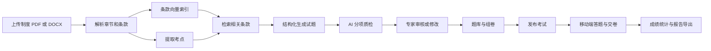

# AI 试题生成系统

从制度文档生成带条款来源的试题，经专家审核后组卷、发布、在线答题并统计结果的 LLM 应用实践项目。

项目围绕企业制度培训场景，提供 React 管理端、独立移动答题端和 FastAPI 后端。使用 Agently 编排结构化生成与 AI 质检，通过 Chroma 检索同制度相关条款，并保留人工审核环节。

> 当前定位：本地演示与学习项目。SSO、HR 系统和企业 IM 尚未真实接入。开发登录允许直接选择角色，请仅在可信本地环境体验。

## 业务流程



## 实现内容

- **制度管理**：上传、章节条款解析、文档详情和删除。
- **AI 出题**：考点提取，单选、多选、判断与填空题生成，结构化结果校验。
- **条款检索**：按制度隔离向量检索，为题目生成补充关联条款。
- **质量审核**：AI 分项质检、异常提示、人工审核及题目修改；AI 质检不代替专家审核。
- **考试流程**：组卷、发布、答题暂存、交卷、判分与考试自动截止。
- **统计与留痕**：多角色统计页面、PDF/Excel 报告和操作审计。

## 技术栈

| 部分 | 技术 |
| --- | --- |
| 管理端 | React 18、TypeScript、Vite、Ant Design、TanStack Query、Zustand |
| 移动端 | React 18、TypeScript、Vite、Ant Design Mobile |
| 后端 | Python 3.10、FastAPI、SQLAlchemy Async、SQLite |
| AI 工作流 | Agently 4.1.3.8、DeepSeek、Pydantic |
| 向量检索 | Chroma、DashScope text-embedding-v4 |
| 文档和报告 | python-docx、PyMuPDF、openpyxl、ReportLab |

## 代码中值得查看的部分

| 关注点 | 实现入口 |
| --- | --- |
| 模型配置与密钥分离 | [Agently 配置](backend/app/ai/agently_setup.py)、[模型配置模板](backend/app/ai/settings.yaml) |
| 结构化生成、结果校验与质检结论 | [题目生成器](backend/app/ai/question_generator.py)、[输出模型](backend/app/ai/models.py) |
| 考点提取、出题与质检提示词 | [Prompt 定义](backend/app/ai/prompts.py) |
| 同制度条款索引与检索 | [向量库](backend/app/ai/vector_store.py) |
| 生成任务与状态衔接 | [生成工作流](backend/app/services/generation_workflow.py) |
| 答题与状态恢复 | [答题接口](backend/app/api/v1/exam_taking.py)、[移动答题页](mobile/src/pages/ExamTaking.tsx) |
| 业务约束和考试流程检查 | [已有测试](backend/tests/) |

## 本地启动

### 环境要求

- Docker Desktop 与 Docker Compose。
- Node.js 20.19+ 和 npm，用于运行两个前端。
- DeepSeek API Key 与阿里 DashScope API Key，用于完整的生成、质检和向量检索体验。调用按服务商规则计费，仓库不提供共享密钥。

后端使用公开的 `python:3.10-slim` 基础镜像；直接依赖版本按原项目运行容器核对并记录在 `backend/requirements.txt`。首次构建需要联网安装依赖。

### 1. 配置环境变量

在仓库根目录执行：

```bash
cp backend/.env.example backend/.env
```

编辑 `backend/.env`，填写自己的 `DEEPSEEK_API_KEY`、`DASHSCOPE_API_KEY` 和随机 `SECRET_KEY`。可用以下命令生成 JWT 签名密钥，再将结果填入文件：

```bash
openssl rand -hex 32
```

本机演示可将 `PUBLIC_BASE_URL` 设为 `http://localhost:5174`。该地址只适用于本机浏览器；手机扫码访问需要另行配置可达的服务地址和访问控制。

`.env`、上传文件、SQLite 数据库和向量库均已加入忽略规则。未配置模型密钥时可以查看页面，AI 相关能力不能完整使用。

### 2. 启动后端

```bash
docker compose up --build -d
```

- 健康检查：<http://localhost:8000/health>
- API 文档：<http://localhost:8000/docs>

数据库会在首次启动时建表，演示产生的数据保存在本地 `backend/` 下。

### 3. 启动管理端

另开一个终端：

```bash
cd web
npm ci
npm run dev
```

访问 <http://localhost:5173>，选择角色进入。

### 4. 启动移动答题端

再开一个终端：

```bash
cd mobile
npm ci
npm run dev
```

访问 <http://localhost:5174>，使用页面的员工登录入口。两个前端的端口不同，登录态不共享。

### 停止服务

前端终端按 `Ctrl+C` 停止；在仓库根目录执行：

```bash
docker compose down
```

也保留了原项目的 `scripts/services.py`，用于 macOS 下的服务启动、停止和状态查询；使用前须已安装前端依赖并配置环境变量。

## 建议演示路线

1. 用“制度专家”角色登录，上传 [虚构制度样例](examples/demo-policy.docx)。内容仅用于软件演示，与真实企业无关。
2. 查看解析后的章节条款，触发 AI 出题，观察任务进度。
3. 打开审核工作台，检查题目、来源条款和 AI 质检分项，再通过或修改题目。
4. 切换为“HR 管理员”，从已审核题目组卷并发布。演示考生范围可选择全部员工。
5. 在移动端以员工身份登录，完成答题和交卷。
6. 返回管理端查看成绩统计和报告。

全新启动时题库、考试和统计为空，需要先完成上述流程。仓库没有预置真实企业资料、真实考生成绩或伪造的业务效果数据。

## 构建与已有测试

前端构建分别在 `web/` 和 `mobile/` 中执行：

```bash
npm ci
npm run build
```

后端已有测试可以使用独立 Python 3.10 虚拟环境运行：

```bash
cd backend
python3 -m venv .venv
source .venv/bin/activate
pip install -r requirements-dev.txt
python -m pytest
```

测试会创建本地测试数据库，应在独立开发副本中运行。`backend/scripts/` 和 `scripts/test_*.py` 中还保留了原有手动验收脚本，部分需要浏览器、运行中的服务或真实模型密钥，不属于默认离线测试。

## 已知限制

- 开发登录允许指定角色和用户，仅用于本地演示；没有完成生产认证和公网部署。
- SSO 回调为占位接口；HR 同步未连接真实 HR 服务；通知记录不会真正外发到企业 IM。
- 推荐上传 PDF、DOCX。旧版 `.doc` 的转换依赖 LibreOffice，当前后端镜像未包含该组件。
- 文档解析失败后仍可能保持“已上传”状态，失败原因主要记录在服务日志中。
- 任务调度、生成任务状态和部分答题缓存位于进程内，未验证多实例和进程重启场景。
- 角色矩阵配置不等于动态授权策略；实际鉴权由后端接口中的角色与数据范围检查决定。权限和个人明细脱敏仍需进一步审计。
- 模型输出质量、等待时间和调用费用会随文档、模型与网络变化；尚无独立评测集或生产性能结论。

## 项目贡献与协作方式

项目所有者主导需求澄清、技术选型、架构取舍与验收反馈，借助 AI 编程工具完成主要代码实现和迭代。项目用于展示业务建模、LLM 工作流设计、工程集成与验收能力，不宣称生产上线或真实客户使用效果。

本仓库是从本地开发项目整理出的公开展示副本，未包含企业制度原文、历史运行数据、开发会话和个人求职材料。

## 展示副本检查记录

整理日期：2026-10-27。以下是本次实际执行的检查，不能替代生产环境验证。

| 检查 | 结果 |
| --- | --- |
| 管理端 TypeScript 与 Vite 构建 | 通过；存在单包体积较大的提示 |
| 移动端 TypeScript 与 Vite 构建 | 通过 |
| 后端已有测试 | 在原项目运行容器的现有依赖下，76 项通过；模型密钥已关闭 |
| 虚构制度解析 | 识别出 4 章、12 条 |
| 敏感内容检查 | 扫描展示目录文本、样例内部 XML，以及与原环境文件中凭据的重复值 |
| 新 Dockerfile 完整构建 | 未完成，Docker Hub 基础镜像请求超时；尚未验证全新镜像中的完整安装与启动 |

前端构建复用了原项目已安装的依赖，未重新联网执行 `npm ci`；本次未调用真实模型生成试题，也未复跑浏览器端到端验收。
